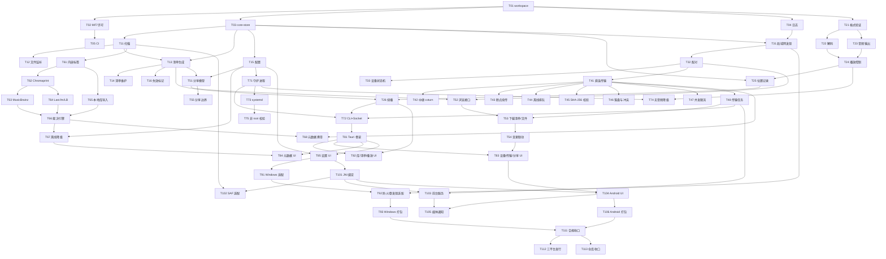

# 音频管理软件 开发排期（依赖顺序版）

## 0. 文档信息

| 项 | 内容 |
|---|---|
| 对应产品文档 | [audio-manager-prd.md](./audio-manager-prd.md) v0.4 |
| 文档版本 | v0.1 |
| 排期口径 | 按依赖顺序与里程碑组织。用户已明确不绑定人力，故本文档不分配日历周期，仅给出工作分解、依赖关系、关键路径与可并行轨道 |
| 交付顺序 | 单平台先行：先打通 Linux（含无头服务）全部 P0 闭环，再横向扩展到 Windows 与 Android |
| 技术栈 | Rust 核心库（跨平台共享）+ Tauri（桌面 UI）+ Kotlin（Android UI，JNI 调 Rust 核心） |

### 0.1 本文档的排期表达方式

- 不写「第 N 周」「预计 M 天」，因为未绑定团队规模，写出的日历时间只能是虚构。
- 用 **里程碑（M0–M11）** 表示交付批次，每个里程碑有明确的进入条件与退出条件。
- 用 **任务 ID（T\*\*）** 表示最小可交付工作单元，并标注其前置依赖。
- 用 **依赖关系图** 与 **关键路径** 表达推进顺序与并行机会。

---

## 1. 技术栈与工程分层

### 1.1 分层

| 层 | 内容 | 说明 |
|---|---|---|
| L0 核心层（Rust） | 库扫描、清单、播放引擎、播放位置、元数据、传输、发现、分享、配置、持久化 | 平台无关，三端共享，是 P0 的主战场 |
| L1 控制层（Rust） | 本地控制通道（Unix Socket / 命名管道）、CLI | 支撑 Linux 无头服务，也被 GUI 复用 |
| L2 界面层 | Tauri（Windows/Linux 桌面）、Kotlin（Android） | 仅做展示与交互，业务逻辑全部下沉到 L0 |
| L3 外部组件 | coturn（中继）、Chromaprint（指纹，子进程） | 按 PRD 决策：coturn 为可选部署组件；Chromaprint 以子进程隔离许可 |

### 1.2 Rust 工作区规划

| 包 | 职责 | 对应需求 |
|---|---|---|
| `core-store` | 清单、播放位置、配置、元数据的持久化与原子写入 | 7.3、FR-09 |
| `core-library` | 音频库、目录扫描、文件监听 | FR-01 |
| `core-playlist` | 清单生成、排序、自动维护 | FR-02 |
| `core-player` | 解码（Symphonia）、播放控制、音频输出 | FR-03 |
| `core-position` | 播放位置记录与续播 | FR-04 |
| `core-cast` | 设备发现、配对、设备状态机 | FR-05 |
| `core-transfer` | 直连/中继传输、断点续传、排队、校验 | FR-06 |
| `core-metadata` | 内嵌标签、指纹、外部来源接入、匹配裁决 | FR-07 |
| `core-share` | 分享模型、对端浏览接口 | FR-11 |
| `core-config` | 配置模型与校验 | FR-09 |
| `core-ipc` | 控制通道协议 | FR-08 |
| `app-daemon` | Linux 无头服务可执行体 | FR-08 |
| `app-desktop` | Tauri 桌面可执行体 | FR-03/FR-09 等 |
| `app-android` | Android 壳（Kotlin + JNI） | 平台适配 |

---

## 2. 工作分解（WBS）

依赖列中的 `—` 表示无前置依赖；其余为必须先完成的任务 ID。

### M0 工程底座

| 任务 | 内容 | 依赖 | 交付物 |
|---|---|---|---|
| T01 | Rust workspace 与各 crate 骨架、模块边界约定 | — | 可编译的空工作区 |
| T02 | MIT LICENSE、依赖许可清单生成与冲突阻断（FR-10） | T01 | LICENSE、许可清单脚本 |
| T03 | `core-store` 持久化层：清单/位置/配置/元数据的存储与**原子写入**（7.3） | T01 | 存储模块 + 崩溃一致性测试 |
| T04 | 日志与诊断基线（结构化日志、FR-09 日志级别、7.6 隐私约束） | T01 | 日志模块 |
| T05 | Linux CI：构建、测试、许可检查（T02）流水线 | T01, T02 | CI 配置 |

**退出条件**：工作区在 Linux 上可构建可测试；许可检查可运行；存储层通过崩溃一致性测试。

### M1 本地库与清单（Linux）

| 任务 | 内容 | 依赖 | 交付物 |
|---|---|---|---|
| T11 | FR-01 目录扫描：扩展名白名单、递归开关、排除规则、符号链接处理 | T03 | 扫描器 |
| T12 | FR-01 文件监听与回退重扫 | T11 | 变更监听 |
| T13 | FR-02 清单生成与排序（自然排序、剥离扩展名、不区分大小写） | T03, T11 | 清单生成器 |
| T14 | FR-02 清单自动维护（增删改移联动、手动顺序模式） | T13 | 清单维护 |
| T15 | FR-09 配置模型（八个配置分组）与合法性校验 | T03 | 配置模块 |
| T16 | FR-01/FR-02 目录不可访问的「失效」标记与恢复 | T13 | 失效处理 |

**退出条件**：对指定目录扫描生成清单；排序符合 FR-02；目录变化自动更新；目录不可访问时清单标记失效且不影响其他目录。

### M2 播放与续播（Linux）

| 任务 | 内容 | 依赖 | 交付物 |
|---|---|---|---|
| T21 | **前置验证**：Symphonia 格式覆盖矩阵（见第 7 章 R1） | T01 | 格式支持结论 |
| T22 | FR-03 解码接入（Symphonia）与不可播放标记 | T21 | 解码层 |
| T23 | FR-03 音频输出接入（PulseAudio / PipeWire）与热插拔处理 | T21 | 输出层 |
| T24 | FR-03 播放控制（播放/暂停/上一首/下一首/跳转/音量/循环模式） | T22, T23 | 播放控制 |
| T25 | FR-04 播放位置记录（5 秒落盘、暂停即写、完成判定 <5 秒） | T03, T24 | 位置记录 |
| T26 | FR-04 续播（打开清单定位续播点并自动播放） | T25, T13 | 续播 |

**退出条件**：打开清单从续播点自动播放；强制退出后重开不丢失超过 5 秒进度；不可解码文件被跳过不中断清单。

### M3 设备发现与配对

| 任务 | 内容 | 依赖 | 交付物 |
|---|---|---|---|
| T31 | FR-05 局域网自动发现（UDP 广播 / mDNS） | T03, T04 | 发现模块 |
| T32 | FR-05 设备标识、配对流程、凭据 | T31 | 配对模块 |
| T33 | FR-05 接收确认策略（默认「每次确认」）与设备状态机、阻止/解除 | T32 | 状态机 |

**退出条件**：局域网内两台设备互相发现并完成配对；阻止后不再接收广播与请求。

### M4 P2P 传输

| 任务 | 内容 | 依赖 | 交付物 |
|---|---|---|---|
| T41 | FR-06 直连传输通道（多文件、双向推送/拉取） | T32 | 直连传输 |
| T42 | FR-06 中继兜底：coturn（TURN/STUN）集成与切换逻辑 | T41 | 中继传输 |
| T43 | FR-06 断点续传（分块、已传字节持久化） | T41 | 续传 |
| T44 | FR-06 离线排队（队列持久化、上限 100） | T41, T03 | 排队队列 |
| T45 | FR-06 SHA-256 校验与失败重试 | T41 | 校验 |
| T46 | FR-06 落地位置策略与同名冲突处理（7.2 四种选项、回收位置 30 天） | T41, T03 | 落盘策略 |
| T47 | FR-06 并发与带宽限制（默认并发 3、带宽不限） | T41 | 限流 |
| T48 | FR-06 传输任务状态机（6 状态）与任务列表 | T41–T47 | 传输任务 |

**退出条件**：直连可传；断网后能从断点续传；对端离线时任务排队并在上线后自动开始；校验失败可重试；同名冲突按 7.2 处理。

### M5 分享

| 任务 | 内容 | 依赖 | 交付物 |
|---|---|---|---|
| T51 | FR-11 分享模型（清单级/文件级开关、两级关系规范） | T13, T15 | 分享模型 |
| T52 | FR-11 对端浏览接口（分享列表 + 元数据摘要，未分享内容不可见） | T51, T32 | 浏览接口 |
| T53 | FR-11 下载整个清单 / 下载单个文件（批量任务创建） | T52, T48 | 下载功能 |
| T54 | FR-11 分享状态变更对进行中任务的影响（5.6.7 五种事件） | T53 | 变更联动 |
| T55 | FR-11 分享范围边界（删除/移出/目录失效/新增文件的分享联动） | T51 | 边界处理 |

**退出条件**：未开启分享的内容对端完全不可见；开启后可浏览；支持下载整个清单与单个文件；分享在传输中关闭时任务转失败。

### M6 元数据同步

| 任务 | 内容 | 依赖 | 交付物 |
|---|---|---|---|
| T61 | FR-07 内嵌标签读取（ID3 / Vorbis Comment / FLAC） | T11 | 标签层 |
| T62 | FR-07 Chromaprint 子进程指纹计算与失败降级 | T61 | 指纹层 |
| T63 | FR-07 MusicBrainz 接入（1 req/s 限速、User-Agent） | T62 | 外部来源 |
| T64 | FR-07 Last.fm（应用级 Key）与 ListenBrainz（匿名）接入 | T62 | 外部来源 |
| T65 | FR-07 本地播放器库文件导入（M3U/M3U8/XSPF/PLS） | T61 | 本地来源 |
| T66 | FR-07 匹配、冲突、待确认与字段级接受/改写（记录状态机） | T63, T64, T65 | 裁决引擎 |
| T67 | FR-07 离线降级、隐私开关与上行字段最小化（7.6） | T66, T15 | 降级与隐私 |
| T68 | FR-07 随文件传输携带元数据（FR-06 §10） | T66, T41 | 元数据携带 |

**退出条件**：同步后同一文件多处展示一致；外部来源不可用时基础层与本地来源仍可用；用户已确认记录不被自动覆盖。

### M7 Linux 无头服务

| 任务 | 内容 | 依赖 | 交付物 |
|---|---|---|---|
| T71 | FR-08 守护进程形态（无 GUI 依赖、单实例检测） | T15 | 守护进程 |
| T72 | FR-08 本地控制入口：CLI + Unix Socket（查询状态、选清单、播放控制、触发同步与传输） | T71, T26, T48 | 控制入口 |
| T73 | FR-08 systemd user service 集成、自启动、崩溃重启 | T71 | 服务单元 |
| T74 | FR-08 无音频设备降级、结构化日志与状态查询 | T71, T24 | 降级与可观测 |
| T75 | FR-08 最小权限与非 root 运行校验 | T73 | 权限校验 |

**退出条件**：无显示服务器环境下可完成扫描、清单、播放、续播、传输、元数据同步；单实例互斥生效；无音频设备时非播放功能不受影响。

### M8 Linux 图形界面（Tauri）

| 任务 | 内容 | 依赖 | 交付物 |
|---|---|---|---|
| T81 | Tauri 应用骨架与核心绑定、IPC 层 | T72 | 应用骨架 |
| T82 | 库 / 清单 / 播放器界面（含不可播放标记、跳过记录） | T81, T26 | 三大界面 |
| T83 | 设备 / 传输 / 分享界面（完整实现 5.6 的 7 个交互子流程） | T81, T54 | 传输分享界面 |
| T84 | 元数据同步界面（字段级确认、状态流转） | T81, T67 | 同步界面 |
| T85 | 设置界面（FR-09 全部配置项） | T81, T15 | 设置界面 |

**退出条件**：Linux 桌面端可通过界面完成 PRD 全部 P0 闭环，交互与 5.6 一致。

### M9 Windows 端

| 任务 | 内容 | 依赖 | 交付物 |
|---|---|---|---|
| T91 | 平台适配：WASAPI 输出、路径处理、注册表/任务计划自启动、托盘 | T85 | Windows 适配层 |
| T92 | 防火墙例外引导与网络发现适配 | T91, T31 | 发现适配 |
| T93 | Windows 打包与发行物 | T92 | 安装包 |

**退出条件**：Windows 端功能与 Linux 桌面端对齐；自启动与托盘可用；发现可跨防火墙提示完成。

### M10 Android 端

| 任务 | 内容 | 依赖 | 交付物 |
|---|---|---|---|
| T101 | Kotlin 壳与 JNI 绑定稳定版 Rust 核心 ABI | T85 | 绑定层 |
| T102 | SAF 目录授权与库扫描适配 | T101, T11 | 存储适配 |
| T103 | 前台服务（mediaPlayback / dataSync）与电池优化白名单引导 | T101, T48 | 后台能力 |
| T104 | Android 界面，功能对齐桌面端 | T101, T83 | 移动界面 |
| T105 | 移动端媒体通知、耳机按键（P1-1） | T104, T103 | 媒体控制 |
| T106 | Android 打包与发行物 | T104 | APK/AAB |

**退出条件**：Android 端可通过 SAF 授权音频库；后台传输与播放符合前台服务约束；拒绝电池白名单时降级为仅前台运行而非崩溃。

### M11 发布与合规收口

| 任务 | 内容 | 依赖 | 交付物 |
|---|---|---|---|
| T111 | 依赖许可清单终版、coturn 与 Chromaprint 隔离方式复核（FR-10） | T93, T106 | 合规结论 |
| T112 | 三平台发行包与版本标签 | T111 | 发行物 |
| T113 | 开源仓库结构与 LICENSE、依赖声明 | T111 | 仓库收口 |

**退出条件**：三平台发行包可安装可运行；许可清单完整且无冲突；MIT LICENSE 随发行包提供。

---

## 3. 依赖关系图



---

## 4. 里程碑总览

| 里程碑 | 名称 | 进入条件 | 退出条件（可验证） |
|---|---|---|---|
| M0 | 工程底座 | — | 工作区可构建可测试；存储层通过崩溃一致性测试；许可检查可运行 |
| M1 | 本地库与清单 | M0 | 扫描生成清单、排序正确、变更自动更新、失效可隔离 |
| M2 | 播放与续播 | M0（T21 可先于 M1） | 从续播点自动播放；崩溃丢失 ≤ 5 秒 |
| M3 | 设备发现与配对 | M0 | 局域网互发现并配对；阻止生效 |
| M4 | P2P 传输 | M3 | 直连/中继、续传、排队、校验、冲突处理全部可用 |
| M5 | 分享 | M1, M4 | 未分享不可见；可下载整个清单与单个文件 |
| M6 | 元数据同步 | M1 | 多端一致；离线可降级；用户确认不被覆盖 |
| M7 | Linux 无头服务 | M2, M4, M5, M6 | 无 GUI 完成全部 P0 能力；单实例生效 |
| M8 | Linux 图形界面 | M7 | 界面完成 P0 闭环，交互符合 5.6 |
| M9 | Windows 端 | M8 | 功能对齐 Linux 桌面端 |
| M10 | Android 端 | M8 | SAF 授权可用；后台约束合规；可安装 |
| M11 | 发布与合规收口 | M9, M10 | 三平台发行包可用；许可无冲突 |

---

## 5. 推进策略

### 5.1 关键路径（决定整体节奏）

```
T01 → T03 → T11 → T13 → T41 → T48 → T53 → T72 → T81 → T85 → T91 → T93 → T111 → T112
```

关键路径的实质：**先有持久化与清单，才有传输；先有传输与分享，才有控制入口与界面；界面完成后才能做平台移植与发布**。其中 M4（传输）与 M7（控制入口）是两处最长的串行段，应优先保证其前序任务不被拖延。

### 5.2 可并行轨道

| 轨道 | 包含 | 可与谁并行 | 备注 |
|---|---|---|---|
| A 数据与清单 | M1 | — | 关键路径起点 |
| B 播放 | M2 | 与 M3、M4、M6 并行 | 需在 M7 前完成 |
| C 网络与传输 | M3 → M4 → M5 | 与 B、M6 并行 | 关键路径中段 |
| D 元数据 | M6 | 与 B、M3、M4 并行 | 需在 M7 前完成 |
| E 服务与界面 | M7 → M8 | 依赖 B、C、D 全部完成 | 串行收口 |
| F 平台移植 | M9、M10 | 两者可并行 | 均依赖 M8 稳定 |

**并行上限**：C、D 两条轨道完全独立，B 依赖 A 但不依赖 C/D，因此 M1 完成后最多可同时推进 B、C、D 三条轨道。这是本方案在单平台先行策略下的最大并行度。

### 5.3 为什么不先做 Windows / Android

PRD 中多处平台差异（Android 的 SAF 与前台服务、Windows 的防火墙与自启动）都是**适配层问题，不是业务逻辑问题**。先用 Linux 打通 L0 核心层（业务逻辑），适配层在 M9/M10 以薄壳形式实现，可避免业务逻辑在三个平台上重复返工。此外 Linux 还需额外承担无头服务（FR-08），先把最"苛刻"的运行环境做通，图形端只是它的增量。

---

## 6. 需要在早期完成的前置验证（Spike）

以下验证项若结论不利，会改变设计而非仅仅影响进度，因此必须在对应里程碑开始前完成。

| ID | 验证项 | 关联 | 触发里程碑 | 若结论不利的应对 |
|---|---|---|---|---|
| R1 | Symphonia 对各格式的实际解码覆盖 | FR-01、FR-03、Q1、Q14 | M2（T21） | 见第 7 章风险 R1 |
| R2 | Chromaprint 子进程在三平台的打包与调用方式 | FR-07、Q8 | M6（T62） | 退回基础层（内嵌标签）匹配，指纹降级为可选 |
| R3 | coturn 部署成本与直连成功率（NAT 穿透） | FR-06、Q7 | M4（T42） | 提高中继权重；若中继不可行则限定局域网，并同步修订 PRD 范围 |
| R4 | Rust 核心以 JNI 供 Android 调用的 ABI 稳定性 | M10 | M10（T101） | 若 ABI 不稳定，Android 端改为独立 Rust 进程 + IPC，增加适配成本 |
| R5 | Tauri 与无头服务共用同一核心的进程模型 | FR-08、M7/M8 | M8（T81） | 若不能共用，桌面端与守护进程分别持有独立核心实例，需增加数据一致性处理 |

---

## 7. 风险与待处理事项

### 7.1 R1：格式白名单与解码能力可能不一致（需尽早决策）

PRD 的 FR-01 白名单包含 `.ape`（Monkey's Audio）与 `.wv`（WavPack），而 Q14 选定的 Symphonia 目前**不支持这两种格式的解码**。

- 当前 PRD 在功能上是自洽的：FR-03 §3 规定「不支持的格式在清单中标记为不可播放」，因此这两种文件仍会被扫描进清单，只是无法播放。
- 但把 `.ape` / `.wv` 放进白名单的意图很可能是期望能播放，若不能播放则白名单条目形同虚设。

**可选处理（需在 T21 前确认）**：

| 选项 | 说明 | 影响 |
|---|---|---|
| A | 保留白名单，接受这两种格式仅被管理不可播放 | 最小改动，但用户预期可能落空 |
| B | 引入第二个解码器（如独立的 FFmpeg 子进程）覆盖 ape/wv | 增加打包体积与许可评估工作量（FFmpeg 许可需单独评估，见 FR-10） |
| C | 从白名单移除 `.ape` / `.wv` | 与「以文件夹形式管理全部音频」的产品意图冲突 |

建议默认按 A 推进以保证主线不受阻，同时把 B 作为 P1 增强项；最终形态待 T21 结论后确定。

### 7.2 其他风险

| ID | 风险 | 关联 | 应对 |
|---|---|---|---|
| R6 | 单平台先行导致后端到 Windows/Android 的时间集中，平台问题集中爆发 | M9、M10 | M9/M10 各保留独立的适配缓冲；M8 完成后先做一次跨平台编译冒烟 |
| R7 | Android 后台限制导致离线排队能力在移动端不可靠 | FR-06、A6 | 已在 PRD 中允许降级为「仅前台运行」；T103 需显式实现降级路径 |
| R8 | 元数据外部来源限流影响同步体验 | FR-07、Q9 | 已定 1 req/s 与跳过重试策略；T66 需实现断点续跑 |
| R9 | 分享与传输的权限边界若实现不严，可能造成非预期内容外泄 | FR-11、4.4 | T52 需以「默认拒绝」实现浏览接口，并配套越权访问测试 |

---

## 8. 本计划未包含的事项

- 日历周期与人力投入：按用户要求不绑定人力，故不分配。
- 量化验收指标：PRD 已声明无基线数据，待首次用户测试后补充。
- 具体 API/数据结构设计：属技术设计文档范畴，将在 M0/M1 期间另行产出。
- 测试用例明细：随各任务的交付物一并产出，不在本文档展开。